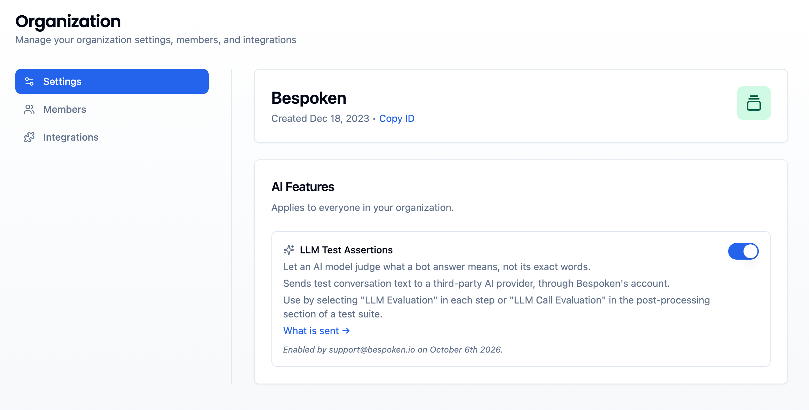
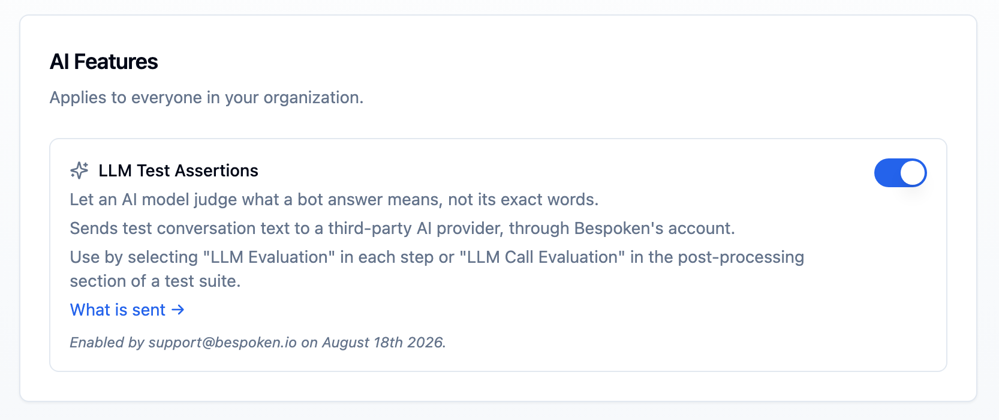

# Organization Management
Use this page to invite team members to your organization so that you can share your Bespoken account and work on tests together. To access this page, simply click on the "Manage" button next to your organization name in the lower left corner of the page.

## Inviting a Member
To invite a new member to your account, enter their email and assign a role to them. Available roles are:
- **Member**: Can manage tests, virtual devices, and see the testing run history.
- **Admin**: In addition to member privileges, admins can add and remove members from the team.

When a new member is invited, you'll see the invitations sent at the bottom. You'll be able to cancel an invitation or resend it if needed. Your invitee will be emailed a link to create their account and join your organization.

## Changing a Member's Role
If you are an admin, changing a teammate's role is as easy as selecting the desired role from the Role dropdown and selecting a new one. Changes are automatically saved.

## Removing a Member
In the same way, removing a member from the team is done by clicking on the trash icon. You will be asked to provide confirmation before successfully removing a member.

## AI Features

The **AI Features** card, under the **Settings** tab of your organization, controls AI-powered features for every project and every user in your organization.

### Enabling LLM Test Assertions

The **LLM Test Assertions** switch enables [LLM Evaluations](/dashboard/test-page/#llm-evaluations) in your tests. It's turned off by default.

Only organization **owners** and **admins** can change this setting; for other members, the switch is disabled. To enable it:

1. Go to **Organization → Settings → AI Features**.
2. Turn on the **LLM Test Assertions** switch.
3. Review what will be sent to the AI provider in the confirmation dialog, then click **I confirm — enable**.

Once enabled, the card shows who enabled it and when. You can review the data-sharing details again at any time by clicking **What is sent →**. To disable the feature, simply turn the switch off.

LLM Evaluations run through Bespoken's account with a third-party AI provider, so you don't need your own API key.

### What Data Is Sent

**Sent to the AI provider:**
- The criteria you write for each test
- The utterances your test sends
- The bot's transcribed responses for that test

This is limited to the current test only, up to the last 20 turns and 12,000 characters of conversation.

**Not sent:**
- Call audio and recordings
- Customer or user identifiers
- Other tests, device settings, or credentials

**Stored:** the model's one-sentence reason is saved with your test results.

::: warning Important
Personal data is **not** removed from transcripts before they are sent. If your tests contain member names, dates of birth, account numbers, or other sensitive information, that text will be sent to the AI provider. Confirm with your privacy or legal team before enabling this feature.
:::
