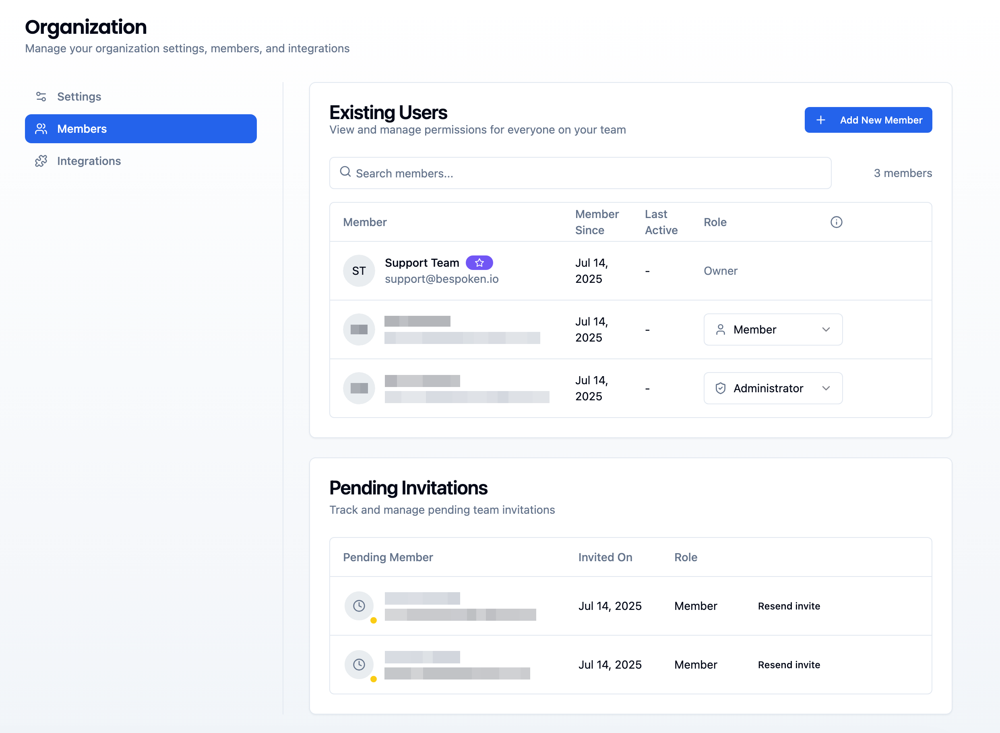
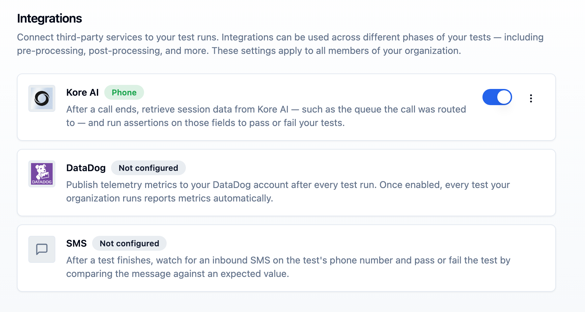

# Organization Management
Use this page to manage your organization's settings, invite team members so you can share your Bespoken account and work on tests together, and connect third-party integrations.

To access this page, open the organization switcher in the lower left corner of the page and click on the **Manage** button next to your organization name. This button is only available to organization **owners** and **admins**.

The Organization page is divided into three tabs, listed on the left side of the page:

1. **Settings**: your organization's name and ID, and AI features.
2. **Members**: your team members and pending invitations.
3. **Integrations**: third-party services connected to your test runs.

## Settings

The **Settings** tab is the default tab of the Organization page. It contains your organization's information and the [AI Features](#ai-features) consent card.

### Organization Information

The organization card shows your organization's name and the date it was created. Click **Copy ID** to copy your organization ID to the clipboard. This is useful when contacting Bespoken support.

### Renaming Your Organization

Owners and admins can rename the organization:

1. Hover over the organization name and click the pencil icon.
2. Enter the new name in the **New Organization Name** field. Names can be up to 100 characters long.
3. Click **Rename Organization**.

The new name is visible to every member of the organization.

### AI Features

The **AI Features** card controls AI-powered features for every project and every user in your organization.

#### Enabling LLM Test Assertions

The **LLM Test Assertions** switch enables [LLM Evaluations](/dashboard/test-page/#llm-evaluations) in your tests. It's turned off by default.

Only organization **owners** and **admins** can change this setting; for other members, the switch is disabled. To enable it:

1. Go to **Organization → Settings → AI Features**.
2. Turn on the **LLM Test Assertions** switch.
3. Review what will be sent to the AI provider in the confirmation dialog, then click **I confirm — enable**.

Once enabled, the card shows who enabled it and when. You can review the data-sharing details again at any time by clicking **What is sent →**. To disable the feature, simply turn the switch off.

LLM Evaluations run through Bespoken's account with a third-party AI provider, so you don't need your own API key.

#### What Data Is Sent

**Sent to the AI provider:**
- The criteria you write for each test
- The utterances your test sends
- The bot's transcribed responses for that test

This is limited to the current test only, up to the last 20 turns and 12,000 characters of conversation.

**Not sent:**
- Call audio and recordings
- Customer or user identifiers
- Other tests, device settings, or credentials

**Stored:** the model's one-sentence reason is saved with your test results.

::: warning Important
Personal data is **not** removed from transcripts before they are sent. If your tests contain member names, dates of birth, account numbers, or other sensitive information, that text will be sent to the AI provider. Confirm with your privacy or legal team before enabling this feature.
:::

## Members

The **Members** tab lists everyone in your organization, along with any invitations that haven't been accepted yet.

### Roles

Every member of your organization has one of the following roles:

- **Owner**: The owner of the organization. This role can't be assigned or removed from the Members tab.
- **Administrator**: Full access to manage organization settings and members. In addition to member privileges, administrators can rename the organization, invite and remove members, change roles, manage AI features, and configure integrations.
- **Member**: Standard access to testing features. Members can create and edit test suites, run tests and view reports, create and manage virtual devices, and access shared resources.

### Existing Users

The **Existing Users** table shows every member of your organization, with their name and email, the date they joined (**Member Since**), when they were last active (**Last Active**), and their role. Your own row is marked with a ★ badge.

Use the **Search members...** box to filter the list by name or email.

#### Changing a Member's Role

To change a teammate's role, select **Administrator** or **Member** from the **Role** dropdown on their row. Changes are saved automatically.

#### Removing a Member

To remove a member, hover over their row and click the trash icon. You will be asked to confirm before the member is removed. This action cannot be undone.

The organization owner can't be removed.

### Inviting a Member

To invite a new member to your organization:

1. Click **+ Add New Member** in the top right corner of the **Existing Users** card.
2. Enter their **Email address** and select a **Role** (Administrator or Member). A description of the selected role is shown below the dropdown.
3. Click **Send Invitation**.

Your invitee will be emailed a link to create their account and join your organization.

::: tip
Invitations are sent one at a time. To invite several people, repeat these steps for each email address.
:::

### Pending Invitations

Invitations that haven't been accepted yet are listed in the **Pending Invitations** card, along with the date each one was sent and the assigned role. From here, you can:

- Click **Resend invite** to send the invitation email again.
- Hover over an invitation and click the trash icon to delete it. You will be asked to confirm before the invitation is deleted.

## Integrations

The **Integrations** tab lets owners and admins connect third-party services to your test runs. Integrations can be used at different stages of your tests, such as pre-processing and post-processing, and apply to all members of your organization.

The following integrations are available:

| Integration | Description |
|---|---|
| Kore AI | After a call ends, retrieve session data from Kore AI — such as the queue the call was routed to — and run assertions on those fields to pass or fail your tests. |
| DataDog | Publish telemetry metrics to your DataDog account after every test run. Once enabled, every test your organization runs reports metrics automatically. |
| SMS | After a test finishes, watch for an inbound SMS on the test's phone number and pass or fail the test by comparing the message against an expected value. |

Click **Configure** on any integration to set it up. Once configured, an integration can be enabled, disabled, or removed, and can apply either to all platforms or to specific ones.

## Switching Organizations

If you belong to more than one organization, open the organization switcher in the lower left corner of the page. Your other organizations are listed under **Other Organizations**, and you can use the **Search organizations...** box to find one quickly. Selecting an organization switches to it and takes you to the home page.

::: tip Note
To create an additional organization, please contact Bespoken.
:::
