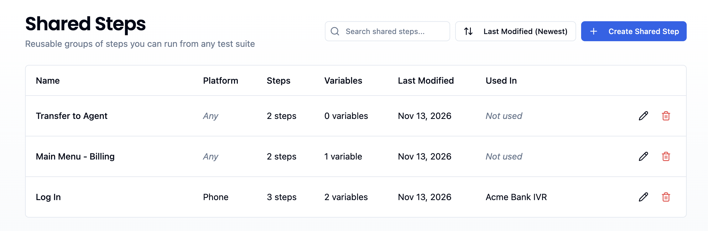
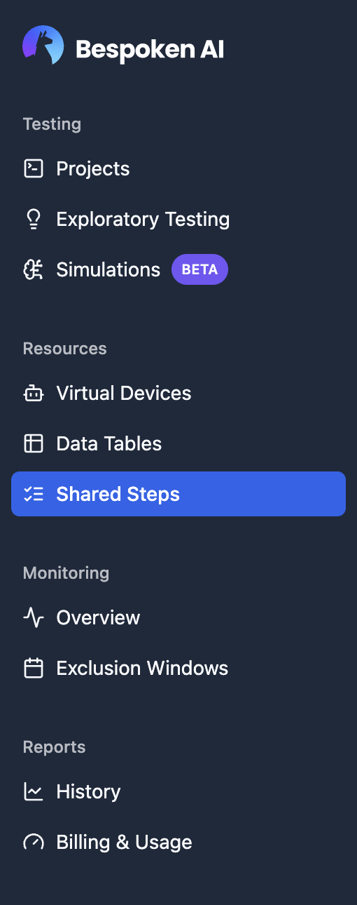
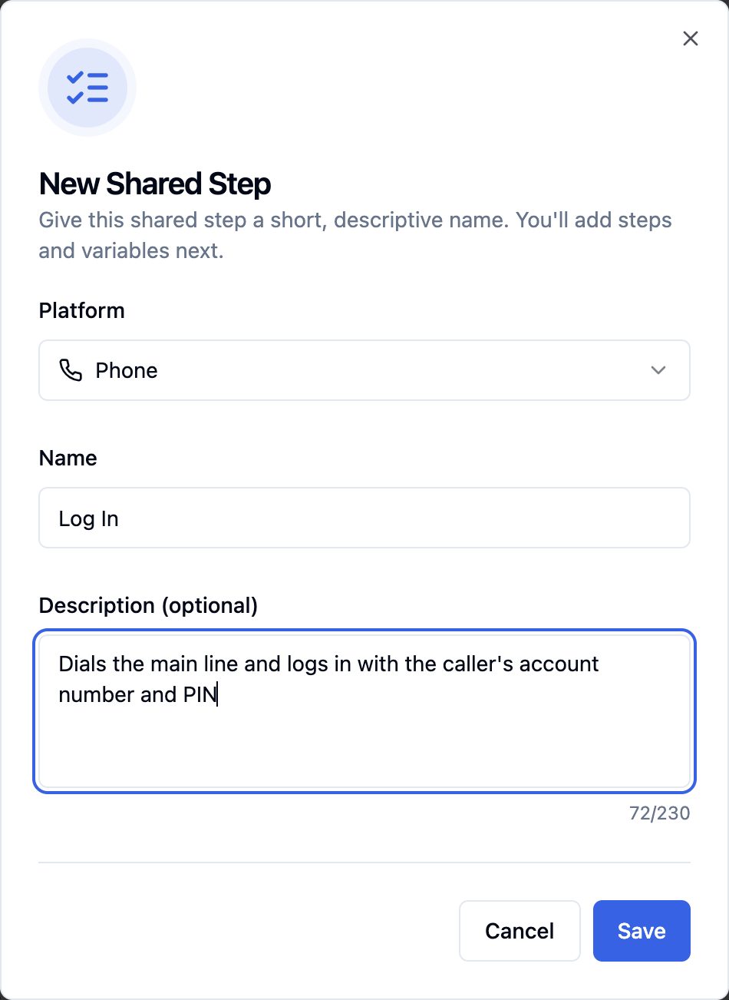
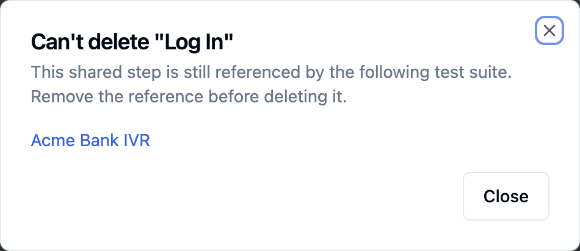
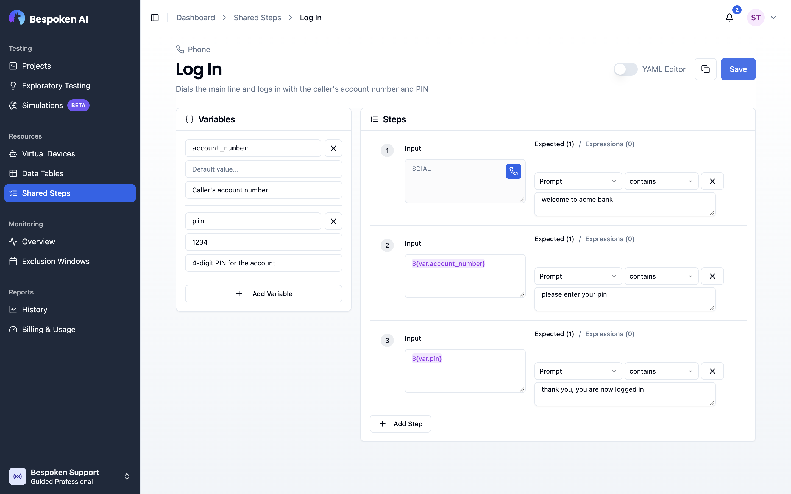
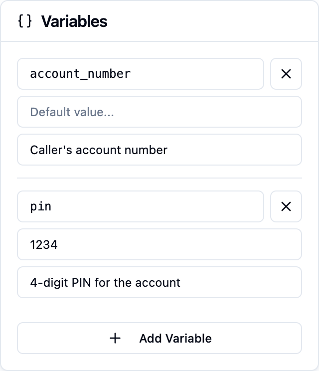
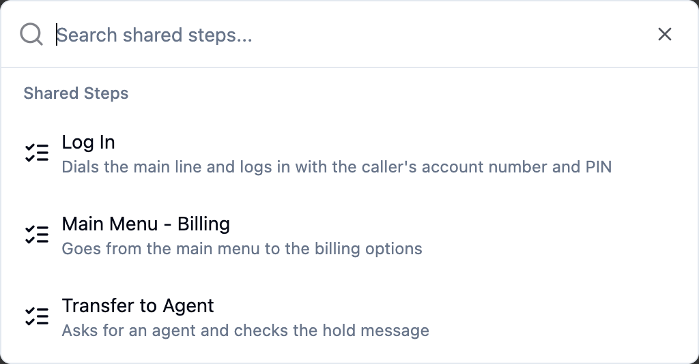
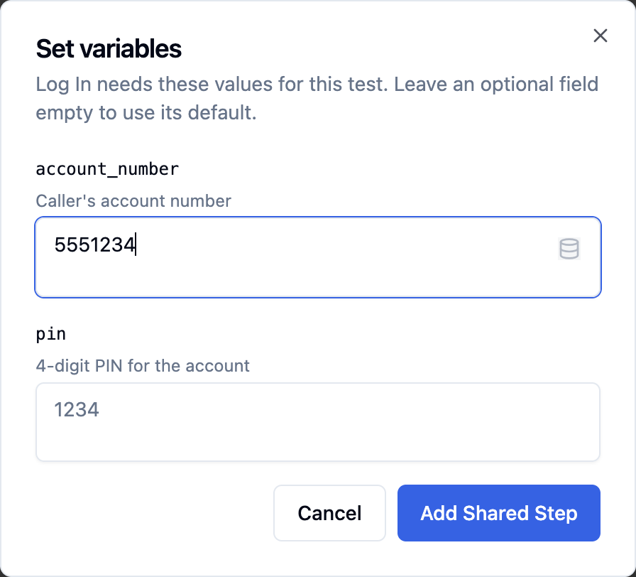
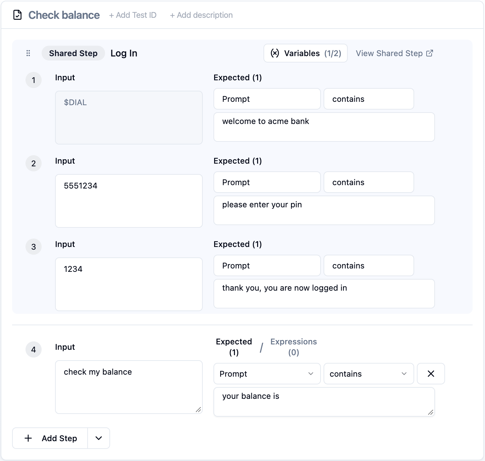
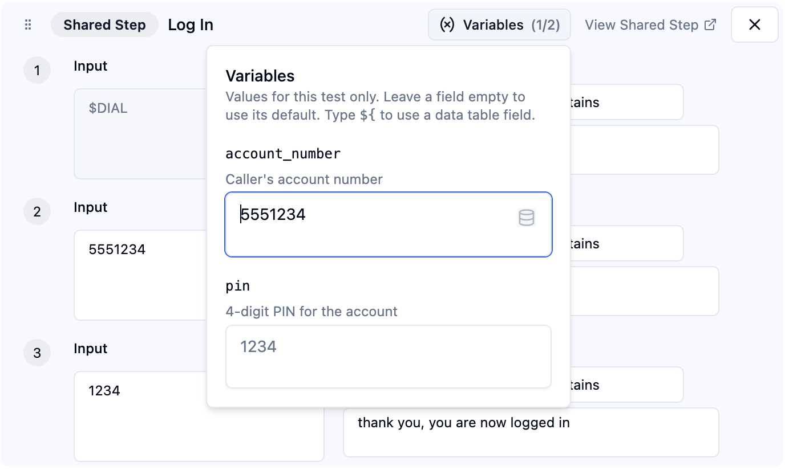

# Shared Steps

Shared Steps let you save a group of steps once and reuse it in any test. They are useful for the parts of a conversation that repeat across many tests, such as dialing in and logging in, going through a main menu, or verifying a caller's identity.

When you edit a Shared Step, every test that uses it picks up the change on its next run. You no longer need to update the same steps in dozens of tests.



::: tip Note
Shared Steps belong to your organization. All members of your organization can use the same Shared Steps in any project and test suite.
:::

::: tip Not seeing Shared Steps?
If **Shared Steps** doesn't appear in your sidebar, it isn't enabled for your account yet. Contact us at [support@bespoken.ai](mailto:support@bespoken.ai) to turn it on.
:::

## Accessing Shared Steps

Shared Steps can be accessed from the **Resources** group in the sidebar, next to Virtual Devices and Data Tables.



## Creating a Shared Step

To create a new Shared Step:

1. Navigate to the **Shared Steps** page.
2. Click **"Create Shared Step"** in the top-right corner.
3. Enter a **name** (at least 3 characters) and an optional **description** (up to 230 characters).
4. Optionally, select a **platform**. Choose "Any platform" if the steps work for any kind of test.
5. Click **"Save"**.



Once created, the Shared Step editor opens so you can add its steps and variables.

::: tip Note
Shared Step names must be unique within your organization.
:::

## Managing Shared Steps

The Shared Steps page lists all the Shared Steps in your organization. For each one you can see its platform, the number of steps and variables, the last modified date, and the test suites that use it (**Used In**).

- **Search**: Use the search bar to find Shared Steps by name or description.
- **Sort**: Sort by Name, Last Modified, or Created date.
- **Open**: Click a row to open the Shared Step editor.
- **Edit Info**: Click the pencil icon to change the name, description, or platform.
- **Delete**: Click the trash icon to remove a Shared Step.

::: warning Note
A Shared Step that is used by a test suite can't be deleted. The delete window lists the test suites that still use it. Remove the Shared Step from those suites first, then delete it. Deleting a Shared Step is permanent.
:::



## Editing a Shared Step

The Shared Step editor works like the [Test Editor](/dashboard/test-page/#test-editor). It has a **Variables** panel on the left and a **Steps** panel on the right.



At the top of the page you can:

- Click the name or the description to edit them.
- Copy the Shared Step ID.
- Switch to the **YAML Editor**.
- **Save** your changes.

::: warning Note
Changes are not saved automatically. Click **Save** when you are done. If you try to leave the page with unsaved changes, the dashboard asks you to confirm.
:::

### Steps

Steps are added and edited the same way as in a test. Each step has an input and one or more expected values. You can:

- Add a step with **Add Step**, or insert one between existing steps.
- Remove a step. You can undo it right away from the notification.
- Reorder steps by dragging them.
- Use **Skip input** on phone, webchat, and Watson Shared Steps, to send no input on that step (see [Silent Input](/dashboard/test-page/#silent-input)).

Before saving, the editor checks your steps with the same rules as the Test Editor and marks any step with errors.

#### Starting a Call ($DIAL)

For phone Shared Steps, step 1 can be a **Dial** step, which calls the number to start the test. This is useful for a Shared Step that covers the start of the call, such as dialing and logging in. A Dial step always stays as step 1 and can't be moved.

### Variables

Variables let each test pass its own values to the Shared Step. For example, a "Log In" Shared Step can use a `pin` variable so that every test logs in with a different account.

To add a variable, click **Add Variable** in the Variables panel and fill in:

- **Key**: The name you use to reference the variable. Only letters, numbers, underscores, and hyphens are allowed, and each key must be unique.
- **Default value** (optional): The value used when a test doesn't set one. A variable without a default value is **required**, so every test that uses the Shared Step must set it.
- **Description** (optional): What the variable is for.



To use a variable in a step, type `${var.<key>}` in the input or in an expected value, or use the **Insert Variable** button. For example:

`Input: ${var.pin}` → `Expected: thank you`

::: tip Note
Inside a Shared Step, you can only use the Shared Step's own variables. To use a value from a data table, pass it from the test as a variable value (see [Setting Variable Values](#setting-variable-values)).
:::

## Using Shared Steps in Tests

### Adding a Shared Step to a Test

1. Open a test in the Test Editor.
2. Click the arrow next to the **Add Step** button and select **Add Shared Step**.
3. Search for the Shared Step by name and select it.
4. If the Shared Step has required variables, enter their values and click **Add Shared Step**.





The Shared Step is added at the end of the test. You can drag it to any position, like any other step.

The list only shows Shared Steps built for your test suite's platform (or for any platform). If some are hidden, turn on **Show All Platforms** to see them. A Shared Step built for another platform can still be added, but it shows a warning.

::: tip Phone tests
On a phone test, a Shared Step that starts with a Dial step is placed as step 1. If step 1 already has content, the dashboard asks you to confirm before replacing it. If you remove that Shared Step later, a plain Dial step is put back so the test still dials first.
:::

### How Shared Steps Look in a Test

In the test, a Shared Step appears as a highlighted group with a **Shared Step** badge and its name. Its steps are shown with the same numbering as the rest of the test, so you can see the whole conversation in order.



The steps inside a Shared Step are read-only in the test. To change them, click **View Shared Step**. The editor opens in a new tab, and your changes apply to every test that uses the Shared Step.

When you run the test, each step inside the Shared Step shows its own result in the **Actual** column, just like regular steps.

### Setting Variable Values

Click the **Variables** button on the Shared Step to set the values for this test. The button shows how many values are set, and warns you when required values are missing.



- Values apply to this test only.
- Leave a field empty to use the variable's default value.
- Type `${` to use a field from the test suite's data table, for example `${data.account_pin}`. See [Working with Test Data](/dashboard/test-page/#working-with-test-data).

The values are saved when you save the test suite.

### Missing Shared Steps

If a test uses a Shared Step that was deleted, the test shows it as **not found**. Remove that step to run the suite.

## Shared Steps in YAML

### Shared Step Definition

In the Shared Step editor, switch to the **YAML Editor** to see or edit the steps as text. The format is the same as a test's steps. The variables go in an optional first `variables` entry:

```yaml
- variables :
    - key : pin
      description : "Account PIN"
      default : "0000"
    - key : city
- $DIAL :
  - prompt : "welcome"
- ${var.pin} :
  - prompt : "thank you"
- weather in ${var.city} :
  - prompt : "the weather in ${var.city}"
```

Each variable can have a `key` (required), a `description`, and a `default`.

The YAML is checked as you type. A Shared Step can't include:

- Another Shared Step
- `test`, `tags`, `settings`, or `hook` entries. Set those on the test instead.
- More than one `---` block

### Using a Shared Step in a Test

In a test suite's YAML, a Shared Step is a `shared_step` entry with its ID, name, and the values for its variables:

```yaml
---
- test: Check weather
- shared_step:
    id: "<shared step id>"
    name: "Log In"
    variables:
      pin: "1234"
      city: "${data.city}"
- what is the forecast for tomorrow: tomorrow
```

You can copy the ID from the Shared Step editor. Variables that are left out use their default value. The `name` is updated automatically when you save the test suite.
