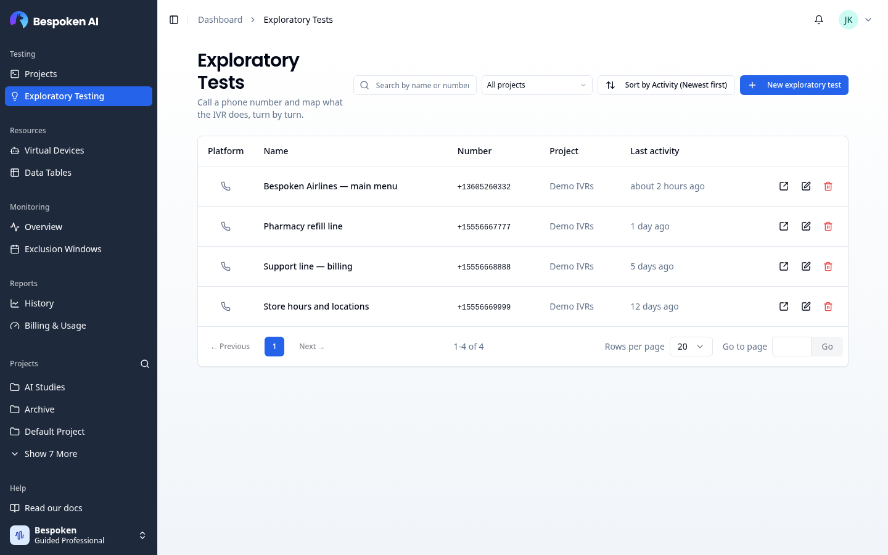
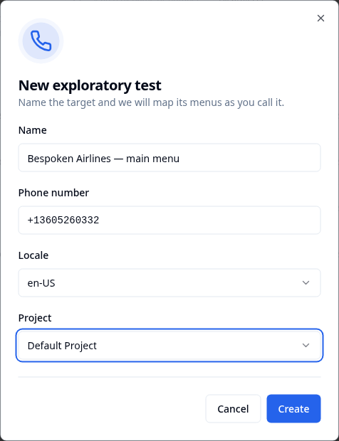
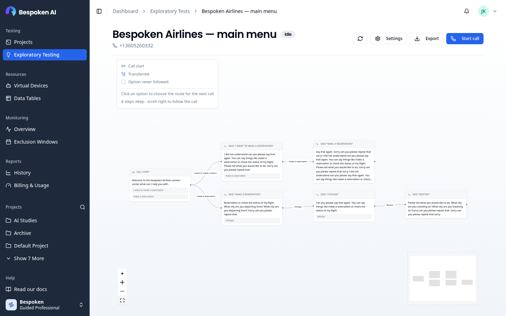
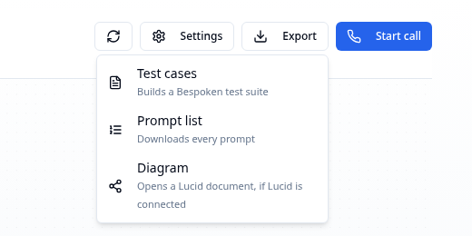
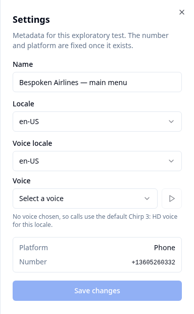
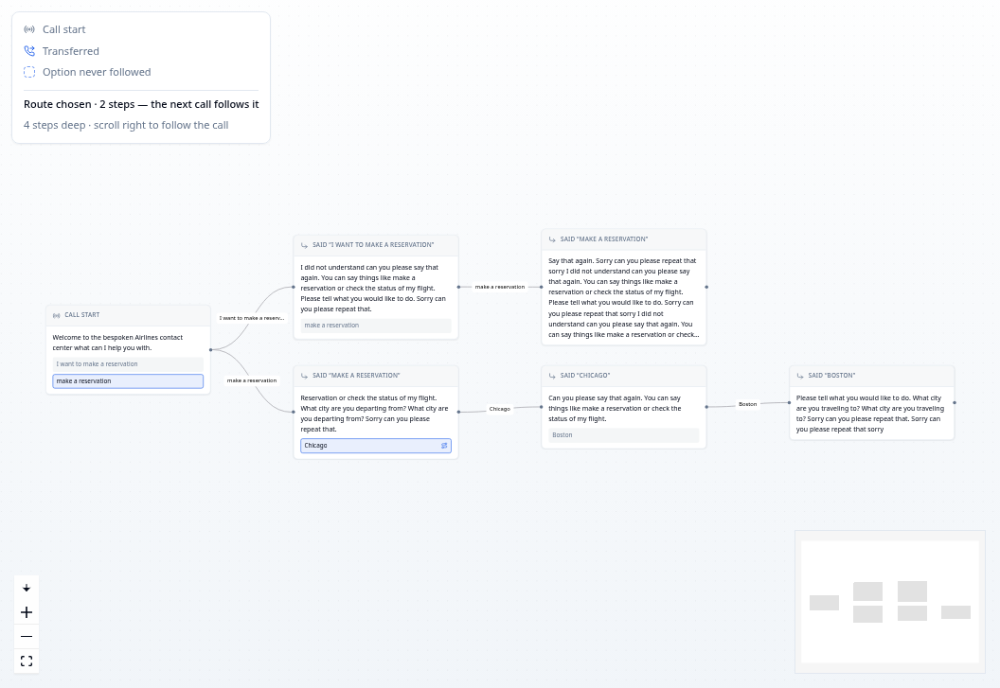
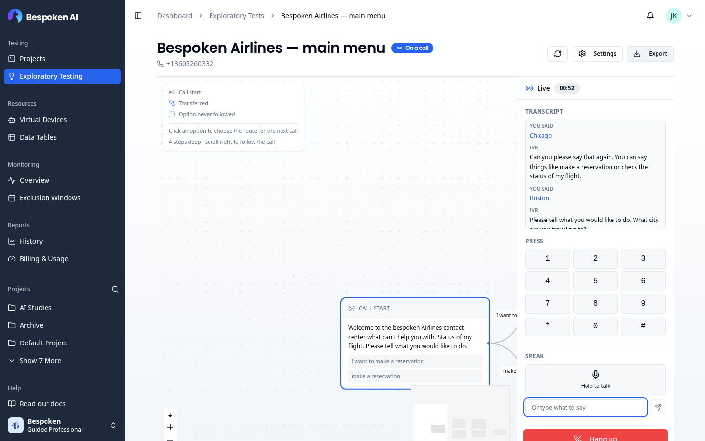
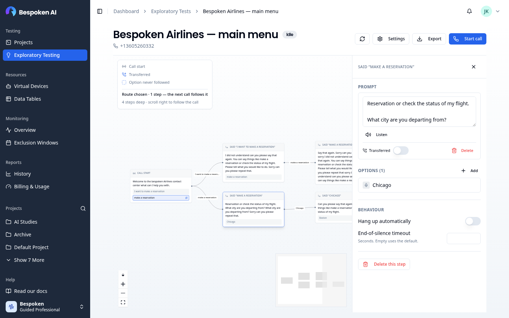

# Exploratory Testing

Exploratory Testing lets you call a phone number from your browser and map what the IVR does, turn by turn. You listen, press keys or speak, and every prompt the IVR plays becomes a node in a graph. You can then correct and annotate that map, choose a route for the next call to follow, and turn the result into a Bespoken test suite.

It is a quick way to learn an IVR you don't know yet, or to document one before writing functional tests for it.

::: tip Note
Exploratory Testing currently supports phone (IVR) numbers only.
:::

## Accessing Exploratory Testing

Click **Exploratory Testing** under the **Testing** group in the sidebar. You'll land on the **Exploratory Tests** page, which lists every exploratory test in your organization.

## The Exploratory Tests Page

Each row shows the test's **Platform**, **Name**, **Number**, **Project** and **Last activity**. Click a row to open its workspace.

At the top of the page you can:

- **Search** by name or number
- **Filter** by project (defaults to **All projects**)
- **Sort** by name or by last activity (newest first by default)

Each row has these actions:

| Action | What it does |
|--------|--------------|
| End call | Shown only while the test is on a call. Ends the call. |
| Open in new tab | Opens the workspace in a new browser tab. |
| Edit | Changes the name, phone number or project. Disabled while the test is on a call. |
| Delete | Removes the test and everything it mapped. This cannot be undone. |

## Creating an Exploratory Test

1. Click **New exploratory test** in the top-right corner
2. Enter a **Name** for the test, for example "Support line — main menu"
3. Enter the **Phone number** to call, in E.164 format (e.g., `+15556667777`)
4. Choose the **Locale** of the IVR: `en-US` (default), `en-GB`, `es-ES` or `es-MX`
5. Choose the **Project** the test belongs to
6. Click **Create**

All fields are required. Once created, you'll be taken straight to the test's workspace.

::: warning Changing the number
You can change the phone number later with **Edit**, but the steps already mapped stay on the graph. If the new number is a different IVR, delete those steps or create a new exploratory test instead.
:::

## The Workspace

The workspace is where you place calls and explore the graph. It has a top bar, the graph in the middle and a side panel on the right: the call panel during a call, or the node inspector when you click a node.

### Top Bar

Next to the test name, a badge shows whether the test is **On a call** or **Idle**. Below it you'll see the phone number and how many options in the whole tree have never been followed (**unexplored**).

- **Refresh** reloads the graph. The graph updates by itself only while you're on a call from this page.
- **Settings** lets you change the name, the locale and the voice used on calls.
- **Export** offers three outputs:
  - **Test cases** builds a new Bespoken test suite from the graph, named `<test name> [GENERATED]`. A notification with an **Open** link takes you to it.
  - **Prompt list** downloads every prompt the IVR played.
  - **Diagram** opens the graph as a Lucid document. This option needs Lucid to be connected for your account; contact Bespoken support if it isn't.
- **Start call** places the call (see [Placing a Call](#placing-a-call)).

### Choosing a Voice

Open **Settings** to pick the voice used when you speak to the IVR. Choose a **Voice locale**, then a **Voice**, and use the play button to hear a sample. Only voices that can be streamed on a live call are listed. If no voice is chosen, calls use the default voice for the test's locale.

Click **Save changes** to apply.

### Reading the Graph

Every prompt the IVR plays becomes a node. The graph starts at **Call start** and grows to the right (or downwards, if you switch to the vertical layout with the button next to the zoom controls).

Each node shows:

- **How the call got there**: "Call start", "Pressed 1", "Said "billing"" or "Continued"
- **The prompt** the IVR played
- **Intents** detected in the prompt, if any
- **Options** found in the prompt: the keys or phrases that lead somewhere else

Options you've already followed are grey. Options never followed have a dashed outline and are marked **unexplored**. A transfer icon marks nodes where the call was transferred out of the IVR.

Use the zoom controls and the minimap to move around large graphs.

### Choosing a Route for the Next Call

Click an option on any node to make the next call follow it. Every option on the way there is highlighted, and the legend shows how many steps the route has. Click the option again to clear it.

With no route chosen, the next call explores on its own.

## Placing a Call

Click **Start call** in the top bar. This places a real phone call to the test's number and records it.

The call panel opens on the right with:

- **Transcript**: what the IVR said, and what you pressed or said
- **Press**: a dialpad (0–9, `*` and `#`)
- **Speak**: hold **Hold to talk** to speak through your microphone, or type a phrase in **Or type what to say** and send it.

The dialpad and speech stay disabled until the IVR plays its first prompt, so nothing you send is lost.

Click **Hang up** to end the call. When it ends, the graph refreshes with everything the call reached.

::: warning Call limits
A call hangs up after 10 seconds of silence and lasts 10 minutes at most. You can change the silence timeout per node (see [Behaviour](#behaviour)).
:::

::: warning Utterance Usage
Exploratory calls consume utterances from your plan. You can follow this usage on the **Billing & Usage** page under **Exploratory Testing**.
:::

## Editing a Node

Click a node to open the node inspector.

### Prompt

Shows the latest transcription of the prompt and how many times it was heard. From here you can:

- **Correct the transcription**: edit the text and click **Save correction**
- **Listen** to the recording
- Mark the prompt as **Transferred**
- **Delete** the prompt. It disappears from the graph and from every export.

Prompts can only be edited once the call ends.

### Options

Lists the ways out of this node. Click **Add** to tell the crawl about an option it didn't detect:

- **Spoken**: a phrase to say, e.g. "billing"
- **Keypad**: a key to press (0–9, `*` or `#`)

You can add an optional description. Click an option to edit it, or use the trash icon to delete it. Deleting an option that was already followed also removes what was found behind it.

### Behaviour

- **Hang up automatically**: turn it off to keep the call on the line at this node.
- **End-of-silence timeout**: how many seconds of silence to wait before moving on. Leave it empty to use the default.

Options and behaviour can be changed during a call. The call picks up the changes on its next turn.

### Deleting a Step

Click **Delete this step** to remove a node. Any steps after it stay and connect to the previous step. This cannot be undone and is only available once the call ends.

## From Exploration to Test Suite

When the graph covers the paths you care about, use **Export → Test cases** to generate a test suite. You can then open it on the [Test page](/dashboard/test-page/) to review the tests, add assertions and run them, or [monitor](/monitoring/) them on a schedule.
